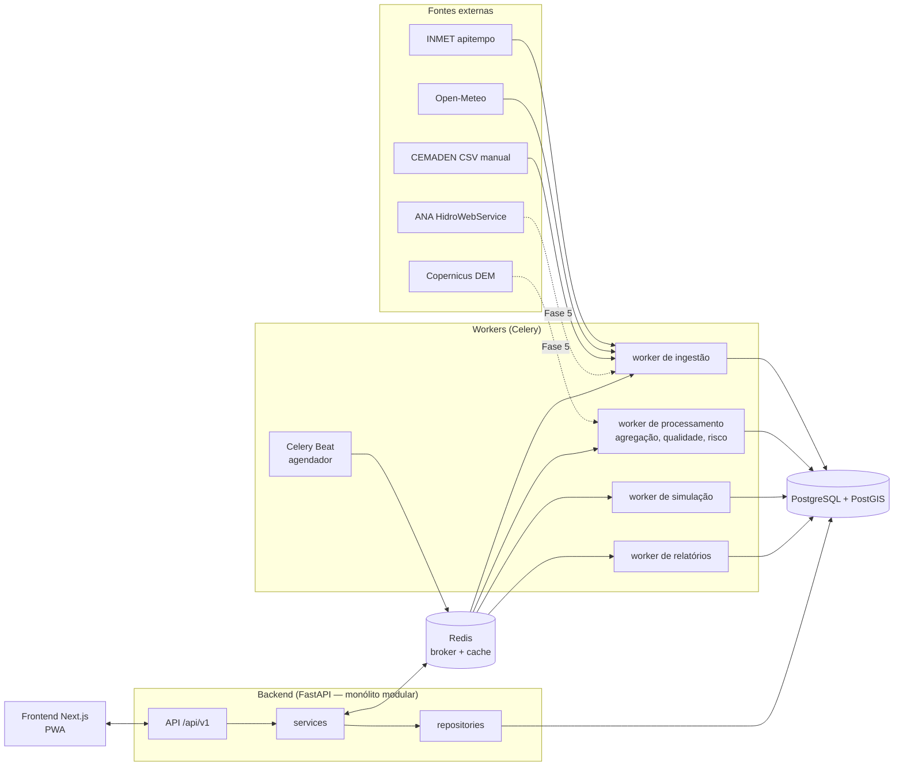
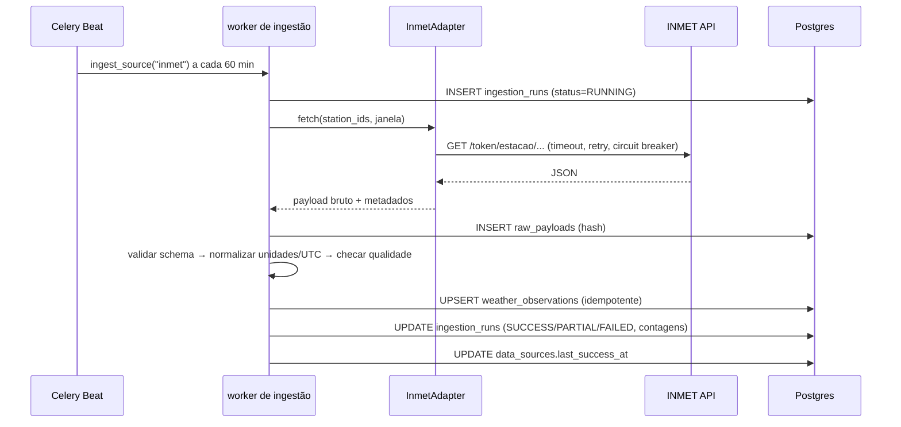
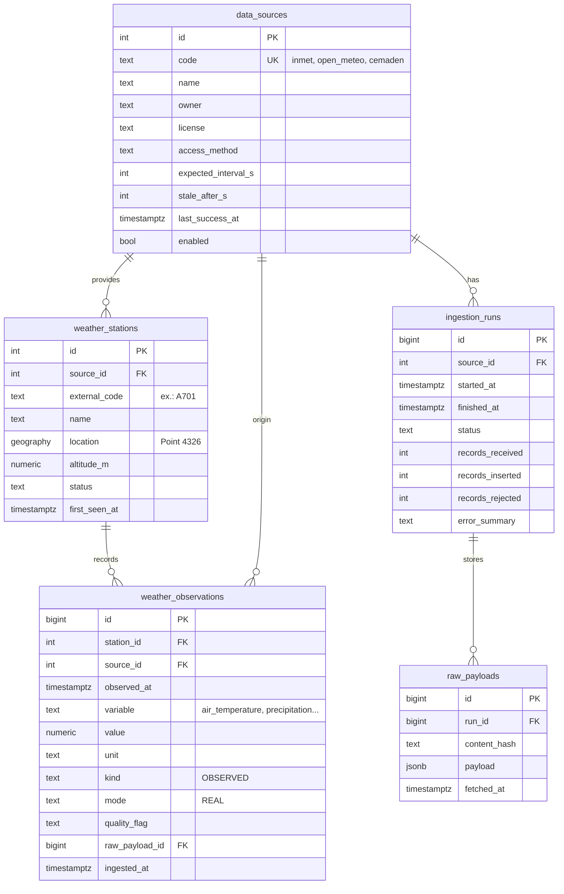

# ARCHITECTURE — Climate Intelligence Platform

> Versão 0.1 (Fase 0) · Estado: proposta

## 1. Visão geral

Monólito modular em Python (FastAPI) com workers Celery separados, PostgreSQL/PostGIS como fonte de verdade, Redis para fila e cache, e frontend Next.js consumindo a API REST `/api/v1`.

## 2. Módulos lógicos

| Módulo | Pasta backend | Responsabilidade | Fase |
|---|---|---|---|
| Core | `app/core/` | config, logging, DB session, erros, segurança | 1 |
| Data Sources | `app/integrations/<fonte>/` | adapters HTTP/arquivo; só buscam e validam schema da fonte | 2 |
| Ingestion | `app/ingestion/` | pipeline: raw → validação → normalização → dedupe → persistência; `ingestion_runs` | 2 |
| Weather Monitoring | `app/services/weather/` | atual, histórico, acumulados, frescor | 3 |
| Forecasting | `app/services/forecast/` | previsão normalizada (Open-Meteo) | 3 |
| Geospatial Engine | `app/geospatial/` | consultas espaciais, proximidade, áreas | 4 |
| Flood Risk Engine | `app/risk/` | hazard × exposure × vulnerability, versionado | 5 |
| Analytics Engine | `app/analytics/` | KPIs, estatísticas, insights por regra | 6 |
| Simulation Engine | `app/simulation/` | cenários com seed, modos SIMULATION/HYBRID | 7 |
| Alerts & Notifications | `app/alerts/`, `app/notifications/` | regras, deduplicação, envio | 9 |
| Reports | `app/reports/` | geração assíncrona PDF/CSV/JSON | 10 |
| Users & Locations | `app/services/users/`, `.../locations/` | autenticação, locais favoritos | 3 |
| Observability | `app/core/observability/` | logs JSON, métricas, `/health`, status de fontes | 1–2 |

Regra de dependência: `api → services → repositories → models`. `integrations` não importa nada de `services`, `risk` ou `api`.

## 3. Fluxo de ingestão (Fase 2)

## 4. Banco de dados — núcleo inicial

Somente tabelas exigidas pelas specs 001–002. Demais entidades da proposta original entram com suas specs.

Decisão de modelagem (formato longo `variable/value`) registrada em ADR-005. Índices iniciais: `UNIQUE(station_id, variable, observed_at)`, `GiST(location)`, `BTREE(observed_at)`, `BTREE(source_id, started_at)`.

## 5. API (contratos iniciais)

| Método | Rota | Fase | Descrição |
|---|---|---|---|
| GET | `/api/v1/health` | 1 | liveness |
| GET | `/api/v1/health/ready` | 1 | readiness (DB, Redis) |
| GET | `/api/v1/sources/status` | 2 | frescor e última coleta por fonte |
| GET | `/api/v1/stations` | 2 | lista paginada, filtro por bbox |
| GET | `/api/v1/stations/nearby?lat&lon&radius_km` | 2 | proximidade (PostGIS) |
| GET | `/api/v1/stations/{id}/observations?from&to&variables` | 2 | série temporal |

Erros padronizados (RFC 9457 Problem Details): `{type, title, status, detail, instance, correlation_id}`.

## 6. Frontend

- `app/` (rotas App Router): `/` (Overview), `/weather`, `/map`, `/risk`, `/analytics`, `/geo-3d`, `/reports`, `/simulation`, `/locations`, `/settings`, `/status`.
- `features/<domínio>/` contém hooks TanStack Query, tipos e lógica; `components/` só apresentação.
- Estado de contexto global (local, período, modo) na URL via search params.
- Módulo 3D carregado por `dynamic(() => import(...), { ssr: false })` apenas em `/geo-3d`.

## 7. Infraestrutura (Fase 1)

`docker-compose.yml` com serviços: `db` (postgis/postgis:16-3.x), `redis`, `backend`, `worker`, `beat`, `frontend`. Todos com healthcheck. Ambiente de desenvolvimento local no Windows via Docker Desktop (WSL2).

## 8. Observabilidade

- Logs JSON com `timestamp, level, correlation_id, source_id, run_id, task_id, event`.
- Middleware gera/propaga `X-Correlation-ID`.
- Métricas iniciais derivadas do banco (`ingestion_runs`, frescor); Prometheus/Grafana avaliados na Fase 11.

## 9. Segurança

Ver Constituição §5. Autenticação (JWT de curta duração + refresh em cookie httpOnly) entra com a spec de usuários/locais (Fase 3); até lá a API é somente leitura.
